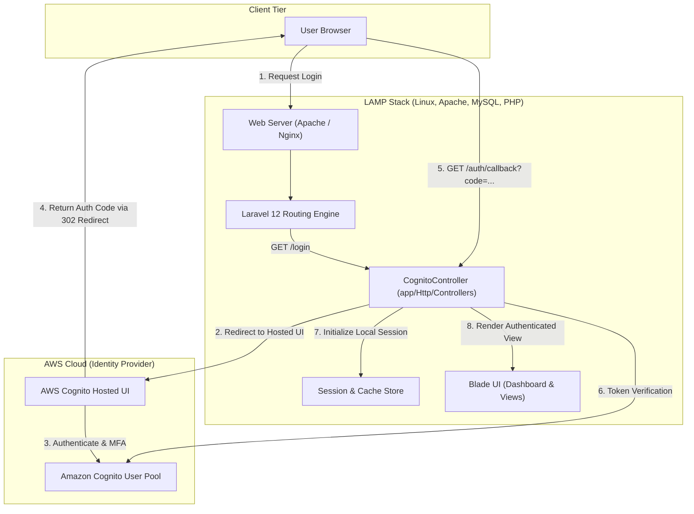
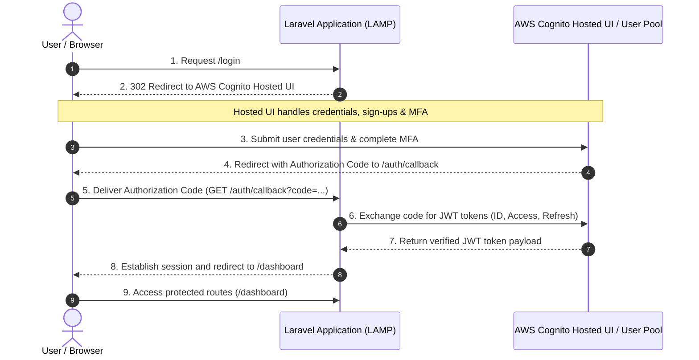

# 🔐 LAMP AWS Cognito Authentication

> Enterprise-grade authentication and session management in Laravel 12 integrated with AWS Cognito User Pools and the LAMP stack.

<p align="left">
  
  
  
  
  
  
</p>

---

## 📌 Overview

This project implements secure cloud identity management by connecting a **Laravel application on the LAMP stack** with **Amazon Cognito User Pools**. It offloads identity verification, multi-factor authentication (MFA), password policies, and token issuance to AWS while maintaining seamless local session handling inside Laravel.

---

## 🏛️ System Architecture Diagram



---

## 🔄 Authentication Sequence Flow



---

## 🧩 Architectural Overview (Text Reference)

```text
+---------------------+                       +-------------------------------+
|                     |   1. GET /login       |                               |
|   User / Browser    | --------------------> |     Laravel Backend (LAMP)    |
|                     | <-------------------- |                               |
+---------------------+   2. 302 Redirect to  +---------------+---------------+
           |                 Cognito Domain                   |
           |                                                  |
           v                                                  v
+------------------------------------+        +-------------------------------+
|     AWS Cognito Hosted UI          |        |     Protected Dashboard       |
|  - Login, Register, Forgot Password|        |  - Session-guarded routes     |
|  - MFA Challenge & Code Issuance   |        |  - Seamless Logout flow       |
+------------------------------------+        +-------------------------------+
```

---

## 🌟 Key Features

- **AWS Cognito Hosted UI Integration**: Leverages Amazon's managed OAuth 2.0 / OpenID Connect login screen.
- **Decoupled Identity Management**: User passwords and MFA are handled securely in AWS Cognito without storing sensitive credentials in the local database.
- **Session Bridge**: Maps Cognito authentication directly to Laravel's native session handling.
- **Modern Frontend Stack**: Integrated with Vite and modern responsive Blade layouts.
- **Ready for LAMP Deployment**: Optimized for Linux, Apache, MySQL, and PHP server environments.

---

## 🛣️ Application Routes

| Method | Route | Controller Method | Description |
| :--- | :--- | :--- | :--- |
| `GET` | `/` | Closure | Welcome page with login initiation button |
| `GET` | `/login` | `CognitoController@login` | Redirects client to Cognito Hosted UI with OAuth parameters |
| `GET` | `/auth/callback`| `CognitoController@callback` | Receives authorization code and authorizes user |
| `GET` | `/dashboard` | `CognitoController@dashboard` | Renders protected dashboard view |
| `GET` | `/logout` | `CognitoController@logout` | Clears local session and redirects to welcome view |

---

## ⚙️ Prerequisites & Setup

### 1. Prerequisites
- **PHP** `>= 8.2`
- **Composer**
- **Node.js** `>= 18` & **npm**
- **AWS Account** with an active Cognito User Pool and App Client

### 2. Installation

```bash
# 1. Clone repository
git clone https://github.com/01aasthajha/lamp-cognito-auth.git
cd lamp-cognito-auth

# 2. Install PHP and Node dependencies
composer install
npm install && npm run build

# 3. Configure environment variables
cp .env.example .env
php artisan key:generate

# 4. Run database migrations
php artisan migrate

# 5. Start the local server
php artisan serve
```

---

## 🔧 AWS Cognito Configuration

In your AWS Cognito Console:
1. Navigate to **User Pools** > Select your pool > **App Integration**.
2. Create or configure an **App Client**.
3. Under **Hosted UI settings**, configure:
   - **Allowed callback URLs**: `http://localhost:8000/auth/callback` (or your domain callback)
   - **Allowed sign-out URLs**: `http://localhost:8000`
   - **Identity providers**: Cognito user pool
   - **OAuth 2.0 grant types**: Authorization code grant
   - **OpenID Connect scopes**: `OpenID`, `Email`, `Phone`
4. Set the credentials in your `.env` file:

```dotenv
COGNITO_CLIENT_ID=your_cognito_app_client_id
COGNITO_CLIENT_SECRET=your_cognito_app_client_secret
COGNITO_REGION=ap-south-1
COGNITO_USER_POOL_ID=ap-south-1_xxxxxxxxx
COGNITO_DOMAIN=https://your-domain.auth.ap-south-1.amazoncognito.com
COGNITO_REDIRECT_URI=http://localhost:8000/auth/callback
```

---

## 📂 Project Structure

```text
lamp-cognito-auth/
├── app/
│   └── Http/
│       └── Controllers/
│           ├── CognitoController.php  # Cognito OAuth redirect & callback handler
│           └── Controller.php
├── config/
│   ├── auth.php                       # Authentication guards & providers
│   └── services.php                   # Third-party service credentials
├── resources/
│   ├── views/
│   │   ├── dashboard.blade.php        # Authenticated user dashboard
│   │   └── welcome.blade.php          # Public welcome page
│   ├── css/
│   └── js/
├── routes/
│   └── web.php                        # Application web routes
├── .env.example                       # Cognito configuration template
├── composer.json                      # PHP packages and dependencies
├── package.json                       # Frontend assets configuration
└── README.md                          # Documentation & Architecture Diagrams
```

---

## 📄 License

Distributed under the [MIT License](LICENSE).
